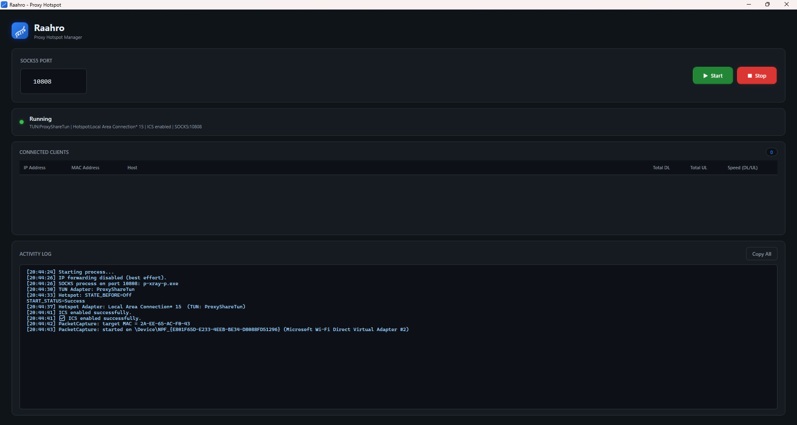
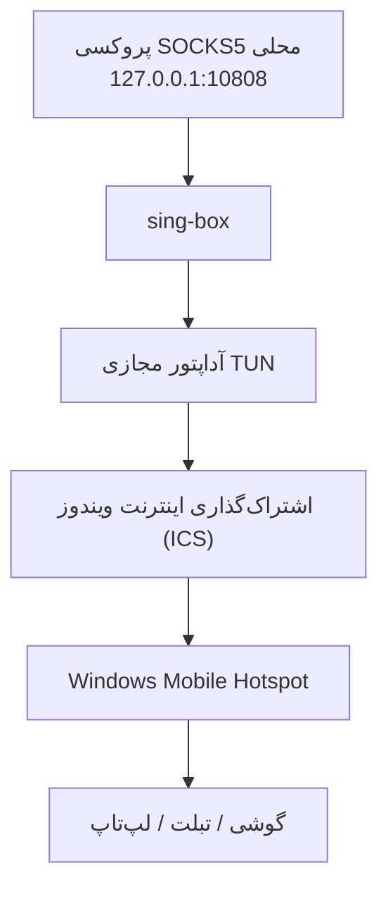

# Raahro

**کامپیوتر ویندوزی خود را به یک هات‌اسپات Wi-Fi مجهز به پروکسی تبدیل کنید.**

Raahro یک نرم‌افزار دسکتاپ ویندوز است که امکان اشتراک‌گذاری اتصال پروکسی SOCKS5 محلی کامپیوتر را با سایر دستگاه‌ها از طریق Wi-Fi Hotspot ویندوز فراهم می‌کند.

این برنامه با استفاده از [sing-box](https://github.com/SagerNet/sing-box) یک آداپتور شبکه مجازی از نوع TUN ایجاد می‌کند، ترافیک شبکه را از طریق پروکسی محلی هدایت می‌کند و این اتصال را با استفاده از Windows Mobile Hotspot در اختیار دستگاه‌های متصل قرار می‌دهد.

با Raahro می‌توانید گوشی، تبلت یا لپ‌تاپ خود را به هات‌اسپات کامپیوتر متصل کنید و از اتصال پروکسی آن استفاده کنید.

<p align="center">
  <a href="readme.md">English</a> | <strong>فارسی</strong>
</p>

## تصاویر برنامه



## قابلیت‌ها

- **اشتراک‌گذاری پروکسی از طریق Wi-Fi:** اتصال SOCKS5 محلی خود را با سایر دستگاه‌ها به اشتراک بگذارید.
- **مدیریت رابط شبکه TUN:** استفاده از sing-box برای هدایت ترافیک شبکه از طریق یک آداپتور مجازی.
- **کنترل خودکار هات‌اسپات:** راه‌اندازی و توقف برنامه‌نویسی‌شده Windows Mobile Hotspot.
- **اشتراک‌گذاری اینترنت (ICS):** اشتراک‌گذاری اتصال پروکسی از طریق آداپتور مجازی TUN با دستگاه‌های متصل.
- **شناسایی دستگاه‌های متصل:** نمایش دستگاه‌ها به همراه IP، آدرس MAC و در صورت امکان نام میزبان (Hostname).
- **مانیتورینگ لحظه‌ای ترافیک:** نمایش سرعت ارسال و دریافت اطلاعات برای هر دستگاه.
- **آمار مصرف ترافیک:** محاسبه مجموع حجم داده‌های ارسالی و دریافتی هر دستگاه.
- **گزارش فعالیت‌ها:** ثبت رویدادها به همراه زمان وقوع برای نظارت بر عملکرد برنامه.
- **پاک‌سازی خودکار:** توقف پردازش‌های پس‌زمینه و بازگرداندن تنظیمات اشتراک‌گذاری شبکه هنگام توقف هات‌اسپات.
- **رابط کاربری تیره:** طراحی مدرن و ساده با استفاده از WPF.
### دانلود

برای استفاده از برنامه، نسخه آماده Raahro را از لینک زیر دانلود کنید:

[دانلود Raahro نسخه 1.0.0](https://github.com/PersianNull/Raahro/releases/tag/v1.0.0)

قبل از اجرای برنامه، مطمئن شوید که [Npcap](https://npcap.com/) را نصب کرده‌اید و هنگام نصب، گزینه **WinPcap API-compatible mode** را فعال کرده‌اید.

پس از استخراج فایل‌های دانلودشده، برنامه `Raahro.exe` را با گزینه **Run as administrator** اجرا کنید.
## نحوه عملکرد

Raahro اتصال Windows Mobile Hotspot را به یک آداپتور شبکه مجازی که توسط sing-box مدیریت می‌شود برقرار می‌کند. این آداپتور ترافیک شبکه را از طریق پروکسی SOCKS5 محلی کامپیوتر هدایت می‌کند.



پس از اتصال، دستگاه‌هایی که به هات‌اسپات متصل می‌شوند می‌توانند از اینترنت از طریق اتصال پروکسی کامپیوتر استفاده کنند.

## پیش‌نیازها

پیش از اجرای Raahro، موارد زیر باید روی سیستم شما فراهم باشند:

- ویندوز 10 یا 11 نسخه 64 بیتی.
- [sing-box](https://github.com/SagerNet/sing-box) نسخه Windows x64.
- [Npcap](https://npcap.com/) با فعال بودن گزینه **WinPcap API-compatible mode**.
- یک سرور پروکسی SOCKS5 فعال روی کامپیوتر.
- دسترسی Administrator برای مدیریت آداپتورهای شبکه و اشتراک‌گذاری اینترنت.

**نکته:** نسخه Self-contained برنامه به نصب جداگانه .NET Runtime نیاز ندارد؛ اما Npcap باید به‌صورت جداگانه نصب شود.

### پیش‌نیازهای توسعه

برای توسعه و Build کردن پروژه به موارد زیر نیاز دارید:

- .NET 10 SDK
- Visual Studio 2022 با پشتیبانی از توسعه WPF
- Git

## راه‌اندازی

### ۱. نصب پیش‌نیازها

ابتدا Npcap را نصب کنید و هنگام نصب، گزینه WinPcap API-compatible mode را فعال کنید.

مطمئن شوید پروکسی SOCKS5 شما روی کامپیوتر در حال اجرا است. برای مثال:

```text
127.0.0.1:10808
```

### ۲. دانلود Raahro

می‌توانید آخرین نسخه آماده برنامه را از بخش Releases دریافت کنید:

[دانلود آخرین نسخه Raahro](https://github.com/YPersianNull/Raahro/releases/latest)

فایل ZIP متناسب با Windows x64 را دانلود و از حالت فشرده خارج کنید.

### ۳. دانلود sing-box

نسخه Windows x64 برنامه sing-box را از لینک زیر دریافت کنید:

[دانلود sing-box](https://github.com/SagerNet/sing-box/releases)

فایل `sing-box.exe` را در کنار فایل اجرایی Raahro قرار دهید.

### ۴. اجرای برنامه

برنامه `Raahro.exe` را با دسترسی Administrator اجرا کنید.

## نحوه استفاده

1. پروکسی SOCKS5 محلی خود را اجرا کنید.
2. برنامه Raahro را با دسترسی Administrator باز کنید.
3. پورت پروکسی SOCKS5 را وارد کنید (پیش‌فرض: `10808`).
4. روی دکمه **Start** کلیک کنید.
5. Raahro سرویس sing-box را اجرا کرده و آداپتور مجازی TUN را ایجاد می‌کند.
6. Windows Mobile Hotspot فعال می‌شود.
7. اتصال آداپتور TUN از طریق Internet Connection Sharing به هات‌اسپات اشتراک گذاشته می‌شود.
8. دستگاه‌های خود را به هات‌اسپات ویندوز متصل کنید.
9. دستگاه‌های متصل و وضعیت ترافیک شبکه آن‌ها را مستقیماً در Raahro مشاهده کنید.

برای متوقف کردن اشتراک‌گذاری، روی دکمه **Stop** کلیک کنید. برنامه پردازش‌های مربوطه را متوقف کرده و تنظیمات شبکه را پاک‌سازی می‌کند.

## تنظیم اولیه ICS در ویندوز

در برخی از سیستم‌های ویندوز، قابلیت Internet Connection Sharing ممکن است پیش از آنکه Raahro بتواند آن را به‌صورت خودکار مدیریت کند، به یک بار تنظیم دستی نیاز داشته باشد.

اگر با خطای زیر مواجه شدید:

```text
0x80040201
An event was unable to invoke any of its subscribers.
```

مراحل زیر را انجام دهید:

1. کلیدهای `Win + R` را فشار دهید.
2. دستور `ncpa.cpl` را وارد کرده و Enter بزنید.
3. آداپتور شبکه TUN مربوط به Raahro را پیدا کنید.
4. روی آن راست‌کلیک کرده و **Properties** را انتخاب کنید.
5. وارد تب **Sharing** شوید.
6. گزینه **Allow other network users to connect through this computer's Internet connection** را فعال کنید.
7. از فهرست موجود، آداپتور Windows Mobile Hotspot را انتخاب کنید.
8. روی **OK** کلیک کنید.

پس از انجام این تنظیم اولیه، Raahro باید بتواند تنظیمات اشتراک‌گذاری را به‌صورت برنامه‌نویسی‌شده مدیریت کند.

## فناوری‌های استفاده‌شده

| بخش | فناوری |
|---|---|
| فریم‌ورک | .NET 10 |
| زبان برنامه‌نویسی | C# |
| رابط کاربری دسکتاپ | WPF / XAML |
| معماری | MVVM |
| ابزار MVVM | CommunityToolkit.Mvvm |
| موتور پروکسی | sing-box |
| دریافت بسته‌های شبکه | SharpPcap |
| پردازش بسته‌های شبکه | PacketDotNet |
| درایور دریافت بسته‌ها | Npcap |
| مدیریت ICS | COM Interop / NETCONLib |
| مدیریت Hotspot | Windows WinRT APIs / PowerShell |
| سریال‌سازی JSON | System.Text.Json |

## معماری پروژه

Raahro از الگوی معماری MVVM استفاده می‌کند و مسئولیت‌های رابط کاربری را از سرویس‌های شبکه و عملیات سیستمی جدا نگه می‌دارد.

```text
Raahro/
│
├── Raahro.csproj
├── App.xaml
├── App.xaml.cs
│
├── MainWindow.xaml
├── MainWindow.xaml.cs
│
├── Models/
│   ├── AdapterInfo.cs
│   ├── BandwidthLimit.cs
│   ├── ClientPolicy.cs
│   ├── ClientTrafficStats.cs
│   └── ConnectedClient.cs
│
├── Services/
│   ├── AdapterService
│   ├── BandwidthPolicyService
│   ├── ClientBlockService
│   ├── ClientDiscoveryService
│   ├── HotspotService
│   ├── IcsService
│   ├── PacketCaptureService
│   ├── SingBoxService
│   └── TrafficMonitorService
│
├── ViewModels/
│   └── MainViewModel.cs
│
└── Helpers/
    ├── AdminHelper.cs
    └── PathHelper.cs
```

### اجزای اصلی

- **SingBoxService:** اجرا و توقف sing-box و مدیریت تنظیمات TUN تولیدشده.
- **HotspotService:** کنترل Windows Mobile Hotspot با استفاده از WinRT APIs از طریق PowerShell.
- **IcsService:** مدیریت Internet Connection Sharing از طریق رابط‌های COM ویندوز.
- **AdapterService:** شناسایی و تشخیص آداپتورهای شبکه.
- **ClientDiscoveryService:** شناسایی دستگاه‌های متصل به هات‌اسپات.
- **PacketCaptureService:** دریافت بسته‌های شبکه برای محاسبه ترافیک هر دستگاه.
- **TrafficMonitorService:** مدیریت آمار ترافیک هر دستگاه و محاسبه سرعت لحظه‌ای.
- **MainViewModel:** هماهنگی سرویس‌های برنامه و مدیریت وضعیت رابط کاربری.

## محدودیت‌های فعلی

برخی از قابلیت‌ها هنوز به‌طور کامل پیاده‌سازی نشده‌اند:

| قابلیت | وضعیت | توضیحات |
|---|---|---|
| مسدودسازی دستگاه‌ها | غیرفعال | قوانین Windows Firewall ترافیک عبوری از ICS را به‌طور قابل‌اعتماد فیلتر نمی‌کنند. |
| محدودیت سرعت هر دستگاه | پیاده‌سازی نشده | به یک راهکار مناسب برای مدیریت و شکل‌دهی ترافیک مانند Windows Filtering Platform نیاز دارد. |
| شناسایی نام میزبان | محدود | ممکن است نام برخی دستگاه‌ها به‌صورت `Unknown` نمایش داده شود. |
| شناسایی آداپتورهای بومی‌سازی‌شده | پشتیبانی ناقص | برخی روش‌های جایگزین شناسایی آداپتور به نام‌های انگلیسی وابسته هستند. |

**نکته مهم:** مانیتورینگ ترافیک در Raahro به‌صورت Passive انجام می‌شود. برنامه در حال حاضر ترافیک شبکه را اندازه‌گیری می‌کند، اما محدودیت سرعت برای هر دستگاه اعمال نمی‌کند.

## مشارکت در توسعه

از مشارکت شما در توسعه Raahro استقبال می‌کنیم.

اگر با مشکلی مواجه شدید یا پیشنهادی برای بهبود برنامه دارید، می‌توانید یک Issue ایجاد کنید یا Pull Request ارسال کنید.

برای تغییرات بزرگ، بهتر است پیش از ارسال Pull Request ابتدا یک Issue ایجاد کنید تا درباره تغییرات پیشنهادی گفتگو شود.

## امنیت و دسترسی‌ها

Raahro با تنظیمات شبکه ویندوز تعامل دارد و برای عملکرد صحیح به دسترسی‌های مدیریتی نیازمند است.

- برنامه را فقط از منابع معتبر دریافت و اجرا کنید.
- از یک پروکسی SOCKS5 معتبر استفاده کنید.
- توجه داشته باشید دستگاه‌های متصل به هات‌اسپات از دسترسی شبکه‌ای پروکسی شما استفاده می‌کنند.
- اطلاعات اتصال و رمز عبور هات‌اسپات خود را در اختیار دیگران قرار ندهید.

## مجوز استفاده (License)

این پروژه تحت مجوز MIT منتشر شده است. برای مشاهده جزئیات، فایل [LICENSE](LICENSE) را مطالعه کنید.

---

ساخته‌شده با ❤️ برای اشتراک‌گذاری آسان‌تر اتصال پروکسی در ویندوز.
