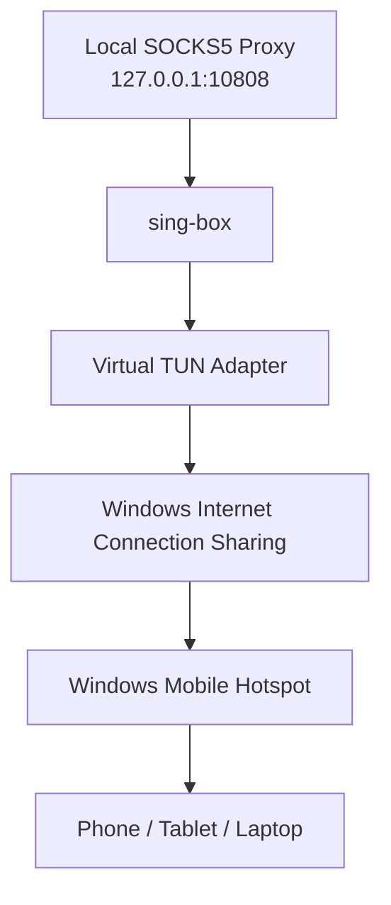

# Raahro

**Turn your Windows PC into a proxy-powered Wi-Fi hotspot.**

Raahro is a Windows desktop application that allows you to share a local SOCKS5 proxy connection with other devices through your PC's Wi-Fi hotspot.

It uses [sing-box](https://github.com/SagerNet/sing-box) to create a virtual TUN network adapter, routes traffic through your local SOCKS5 proxy, and shares that connection over Windows Mobile Hotspot.

Connect your phone, tablet, or laptop to your PC's hotspot and let it use the same proxy connection.

## Features

- **Proxy-powered Wi-Fi hotspot** — Share your local SOCKS5 connection with other devices.
- **TUN interface management** — Uses sing-box to route network traffic through a virtual TUN adapter.
- **Automatic hotspot control** — Starts and stops Windows Mobile Hotspot programmatically.
- **Internet Connection Sharing (ICS)** — Shares the proxy-enabled TUN connection with connected devices.
- **Connected device discovery** — Displays connected clients, including their IP and MAC addresses, and hostnames when available.
- **Live traffic monitoring** — Shows per-device upload and download speeds.
- **Traffic statistics** — Tracks cumulative upload and download usage for each connected device.
- **Activity logs** — Provides timestamped logs for monitoring application operations.
- **Automatic cleanup** — Stops background processes and resets network sharing when the hotspot is stopped.
- **Dark interface** — A clean, modern WPF interface.

## How It Works

Raahro connects Windows Mobile Hotspot to a virtual network adapter managed by sing-box. The virtual adapter routes traffic through the SOCKS5 proxy running locally on your PC.



Once connected, devices using the hotspot can access the internet through the configured proxy connection.

## Requirements

Before running Raahro, make sure you have:

- Windows 10 or Windows 11 (x64).
- .NET 10 Runtime.
- A local SOCKS5 proxy server.
- [sing-box](https://github.com/SagerNet/sing-box) for Windows x64.
- [Npcap](https://npcap.com/) installed with **WinPcap API-compatible mode** enabled.
- Administrator privileges.

### Development Requirements

- .NET 10 SDK.
- Visual Studio 2022 with WPF development support.
- Git.

## Getting Started

### 1. Install the Prerequisites

Install Npcap and enable WinPcap API-compatible mode during installation.

Make sure your SOCKS5 proxy is running locally. For example:

```text
127.0.0.1:10808
```

### 2. Download Raahro

Clone the repository:

```bash
git clone https://github.com/YPersianNull/Raahro.git
cd Raahro
```

### 3. Download sing-box

Download the Windows x64 release of sing-box:

[sing-box Releases](https://github.com/SagerNet/sing-box/releases)

Place `sing-box.exe` next to the Raahro executable after building the application.

### 4. Build the Project

Restore NuGet packages:

```bash
dotnet restore
```

Build the application:

```bash
dotnet build -c Release
```

### 5. Run as Administrator

Raahro requires administrator privileges to manage network adapters, Windows Mobile Hotspot, Internet Connection Sharing, and packet capture.

Run the application as Administrator.

## Usage

1. Start your local SOCKS5 proxy.
2. Launch Raahro as Administrator.
3. Enter the SOCKS5 listening port (default: `10808`).
4. Click **Start**.
5. Raahro starts sing-box and creates the virtual TUN adapter.
6. Windows Mobile Hotspot is activated.
7. The TUN adapter is shared through Internet Connection Sharing.
8. Connect your devices to the Windows hotspot.
9. Monitor connected clients and their network traffic directly from Raahro.

Click **Stop** to shut down the proxy-sharing process and clean up the network configuration.

## First-Time ICS Configuration

On some Windows installations, Internet Connection Sharing may require a one-time manual configuration before Raahro can enable it programmatically.

If you encounter the error:

```text
0x80040201
An event was unable to invoke any of its subscribers.
```

Follow these steps:

1. Press `Win + R`.
2. Enter `ncpa.cpl` and press Enter.
3. Find the Raahro TUN network adapter.
4. Right-click it and select **Properties**.
5. Open the **Sharing** tab.
6. Enable **Allow other network users to connect through this computer's Internet connection**.
7. Select the Windows Mobile Hotspot adapter from the dropdown.
8. Click **OK**.

After completing this configuration once, Raahro should be able to manage the sharing configuration programmatically.

## Technology Stack

| Component | Technology |
|---|---|
| Framework | .NET 10 |
| Language | C# |
| Desktop UI | WPF / XAML |
| Architecture | MVVM |
| MVVM Toolkit | CommunityToolkit.Mvvm |
| Proxy Engine | sing-box |
| Packet Capture | SharpPcap |
| Packet Parsing | PacketDotNet |
| Packet Capture Driver | Npcap |
| Internet Connection Sharing | COM Interop / NETCONLib |
| Hotspot Management | Windows WinRT APIs / PowerShell |
| JSON Serialization | System.Text.Json |

## Project Architecture

Raahro follows the MVVM architectural pattern and separates UI responsibilities from networking and system-level operations.

```text
Raahro/
│
├── Raahro.csproj
├── App.xaml
├── App.xaml.cs
│
├── MainWindow.xaml
├── MainWindow.xaml.cs
│
├── Models/
│   ├── AdapterInfo.cs
│   ├── BandwidthLimit.cs
│   ├── ClientPolicy.cs
│   ├── ClientTrafficStats.cs
│   └── ConnectedClient.cs
│
├── Services/
│   ├── AdapterService
│   ├── BandwidthPolicyService
│   ├── ClientBlockService
│   ├── ClientDiscoveryService
│   ├── HotspotService
│   ├── IcsService
│   ├── PacketCaptureService
│   ├── SingBoxService
│   └── TrafficMonitorService
│
├── ViewModels/
│   └── MainViewModel.cs
│
└── Helpers/
    ├── AdminHelper.cs
    └── PathHelper.cs
```

### Key Components

- **SingBoxService** — Starts and stops sing-box and manages its generated TUN configuration.
- **HotspotService** — Controls Windows Mobile Hotspot using WinRT APIs through PowerShell.
- **IcsService** — Manages Internet Connection Sharing through Windows COM interfaces.
- **AdapterService** — Detects and identifies network adapters.
- **ClientDiscoveryService** — Discovers devices connected to the hotspot.
- **PacketCaptureService** — Captures network packets to calculate per-client traffic.
- **TrafficMonitorService** — Maintains per-client traffic counters and calculates live speeds.
- **MainViewModel** — Coordinates application services and manages UI state.

## Current Limitations

Some features are not yet fully implemented:

| Feature | Status | Notes |
|---|---|---|
| Client blocking | Not working | Windows Firewall rules do not reliably filter ICS-forwarded traffic. |
| Per-client bandwidth limits | Not implemented | Requires a suitable traffic-shaping solution, such as Windows Filtering Platform (WFP). |
| Hostname resolution | Limited | Some connected devices may appear as `Unknown`. |
| Localized adapter detection | Partially supported | Some adapter-detection fallbacks depend on English adapter names. |

**Important:** Traffic monitoring is passive. Raahro currently measures network traffic but does not enforce per-client bandwidth restrictions.

## Contributing

Contributions, bug reports, and feature suggestions are welcome.

If you find a bug or have an idea for improvement, feel free to open an issue or submit a pull request.

For major changes, please open an issue first to discuss what you would like to change.

## Security & Permissions

Raahro interacts with Windows network configuration and requires elevated privileges.

- Run the application only from a trusted source.
- Use a trusted local SOCKS5 proxy.
- Be aware that connected devices share the network access provided by your proxy.
- Do not expose your hotspot credentials publicly.

## License

This project is licensed under the MIT License. See the [LICENSE](LICENSE) file for details.